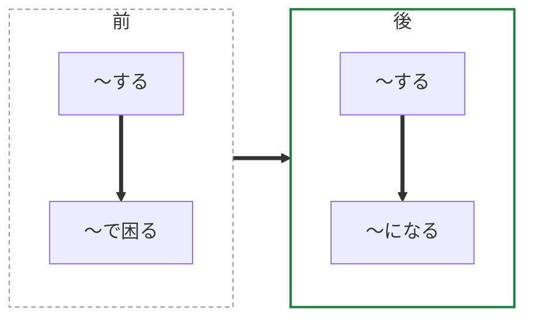
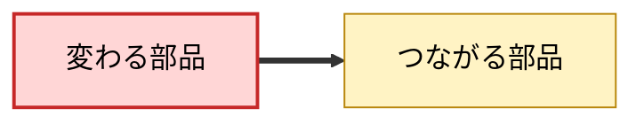

<!-- hirai-lite: pull_request_template v2 -->
<!--
PR の本文の型（4 種別）。読む人が「何のためで、どう解いて、何が変わり、どこを見ればよいか」を、抽象から具体の順に追える並びにする。
コードの変え方から書き始めない。背景と書き方は、hirai-lite のプラグインに入っている docs/rules-reference/git-and-pr.md の §9。
種別は見える 1 行目に 1 つ（名前はこのまま。かぎかっこは付けない）:
- 見える変更: 画面・API の振る舞い・通知・見える不具合の直し
- 見えない変更: CI・ハーネス・インフラ・依存・リファクタ・意味を変えない文書の直し
- 設計・決定の文書: 設計・ADR・決まりの文など、決めることの中身が本文の PR。「何が変わるか」を「何を決めるか」に、「テストの結果」を「テストの計画」に替える
- release: 既定の branch から本番へ。下の節を使わず「含むもの → release note（項目ごとに前は・今は・実物）→ 取り込みの安全面（影響の合計・戻し方・反映の順）→ 承認カード → 対応する issue」にする
境目: 文書だけ（設計・ADR・決まりの文）なら 設計・決定の文書、動くもの（検査・CI・script）が変わるなら 見えない変更、両方なら動くものの種別。
画面のキャプチャ: draft で PR を作り、`hirai-pr-asset <PR 番号> <png ...>` で branch pr-assets に置き、出た 1 行を貼って本文を更新する。
読み手の判断に使わない長い一覧は 
 で畳む（「何のため」と「全体像」の節は畳まない）。
「## 対応する issue」は、issue の参照の書き方（`Closes #<n>`・台帳の形は `task-<id>`）を 1 行 1 件で書く。
-->

種別:
利用者への影響: 前は〜できなかった。今は〜できる（見える変化が無ければ NONE。設計だけなら NONE と、実装が入るとできること）
決めてほしいこと: 〜を取り込むか（ほかにあれば 1 行ずつ）
task: 〜を閉じる（残りの数・止めているもの）

## 何のため・どう解決するか

<!--
release のほかは必須。頭の 4 行の直後に置く。専門語を避け、困っていること・目的・どう解決するか は各 3 行まで、採らなかった案は 1 案 1 行。
材料は issue・設計から取り、無い事実を作らない（測っていない数は「未測定」と書く）。
-->

### 困っていること

誰が・いつ・何に困っているか（数字か issue）

### 目的

どの feature・ゴールの、どの部分か（リンク）

### どう解決するか

〜を〜に変える（1〜3 行）

<!--
文のすぐ下に、前 → 後が分かる mermaid の図を 1 枚だけ置く（左に前・右に後）。GitHub は PR の本文の mermaid を描く。
書き方の例（使うときは注の外へ出す。注の中ではハイフン 2 つと > を続けた矢印を書けない。注が閉じて、例が描かれてしまうため。例は = 2 つと > の太い矢印で書いてある）:

-->

### 採らなかった案

- 〜する案: 採らなかった理由（無ければ「なし: 理由」）

## 何が変わるか

<!--
出力の実物の前と後を左右に並べる。画面は前後のキャプチャ、API・CLI・通知は要求と応答や文面の前後、CI や検査は「こういう変更が、こう落ちる」の実際の文、文書は描画した前と後。
画面が変わる設計は、これからの見た目の絵を後に置く（前の画面が在れば前も絵、無ければ「無い（新しい画面）」）。
-->

| 前  | 後  |
| --- | --- |
|     |     |

## 基本設計の全体像のどこが変わるか

<!--
release のほかは必須。図とリンクだけ（説明の文・表・箇条書きを置かない）。リポの基本設計の図（構成・画面の流れ・API の口・ER・状態・権限・通知とジョブ・インフラ・監視・CI）のうち、変わる物の図を写し、
変わる所に色を付ける（赤 = 変わる、黄 = つながる所、灰 = 変わらない）。変わらない物の図は載せない。図の下に元の文書へのリンクを 1 行。
どの図も変わらなければ「変わる所はない」と理由を 1 行。リポに基本設計の図が無ければ「基本設計の図が無い」と 1 行。図を差分から出す道具があるリポは、その出力を貼る。
色の付け方の例（写した図の末尾に足し、変わる node と つながる node の id を書く。使うときは注の外へ出す）:

-->

## 壊れうる所と戻し方

| 影響                                   | あり / なし | 反映手順 |
| -------------------------------------- | ----------- | -------- |
| データ（DB・移行）                     |             |          |
| 設定・環境変数                         |             |          |
| 外に出している口（API・CLI・設定の形） |             |          |
| インフラ・権限                         |             |          |

- 戻し方:
- 壊れうる所と守り:
- 読む順: 1. `path` — 見ること
- 読まなくてよい:

## テストの結果

<!-- 振る舞いごとに 1 行。結果は実際に走らせたコマンドと exit code と件数。未検証は「未検証」と書く。設計・決定の文書は「テストの計画」にし、列を「振る舞い・確かめ方・壊して確かめる所」に替える。 -->

| 振る舞い | テスト（file・名前） | 結果（コマンド・exit code・件数） | 実物（キャプチャ・ログ） |
| -------- | -------------------- | --------------------------------- | ------------------------ |
|          |                      |                                   |                          |

## 進み具合

- 閉じる task:
- 残り:
- 止めているもの:

## 承認カード

<!-- merge を頼むときの 7 行。1 行目は「決めること: 〜を取り込むか。推奨: 〜」。型は docs/rules-reference/approval-template.md。400 字以内。 -->

**決めること**: 。**推奨**:
**目的**:
**位置**:
**承認すると**: 。戻せる
**しないと**:
**注意**:
**詳しく**:

## 対応する issue

<!-- 必須。1 行 1 件。設計と ADR は path と役割を 1 行ずつ添える。issue を立てない PR は「なし」と書く。 -->

Closes #

設計:
ADR:
