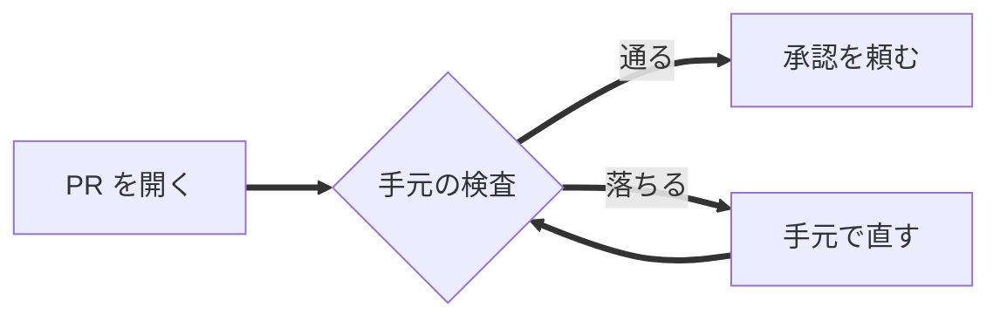

<!-- hirai-lite: pull_request_template v1 -->
<!--
PR の本文の型（9 節）。読む人が「何に困っていて、どう解いて、どこを読めばよいか」を、抽象から具体の順に追える並びにする。
コードの変え方から書き始めない。背景と書き方は docs/rules-reference/git-and-pr.md の「PR の本文の型」。
画面のキャプチャ: `hirai-pr-asset <PR 番号> <png ...>` で branch pr-assets に置き、出た 1 行を「何が変わるか」に貼る。
「## 対応する issue」は、issue の参照の書き方（`Closes #<n>`・台帳の形は `task-<id>`）を 1 行 1 件で書く。
-->

## ひとことで

<!-- 課題と解決を 2 行。1 行目は何に困っていたか、2 行目はどう解いたか。 -->

## 課題

<!-- 誰が・いつ・何に困るか。起きた事故と数字（件数は何の件数かを書く。例: 「失敗した run 70 本・PR 32 本」）。 -->

## 解決の方針

<!--
考え方と、採らなかった案とその理由。
流れ・つながり・前後の違いは、文の前に mermaid の図で全体像を置く（図は文の代わりではない）。
処理の流れは flowchart、やり取りは sequenceDiagram、状態の移り変わりは stateDiagram、表の関係は erDiagram。GitHub は PR の本文の mermaid を描く。
書き方の例（使うときは注の外へ出す。注の中ではハイフン 2 つと > を続けた矢印を書けない。注が閉じて、例が描かれてしまうため。例は = 2 つと > の太い矢印で書いてある。注の外へ出したら普通の矢印に戻してよい）:

-->

## 何が変わるか

<!-- 前と後。流れや状態が変わるなら、前と後の mermaid の図を表の前に置く。画面は前後のキャプチャを並べる。CI や検査は「こういう変更が、こう落ちる」の例を 1 つ書く。 -->

|     | 前  | 後  |
| --- | --- | --- |
|     |     |     |

## 読む順

<!-- 3〜5 本。ファイルと、そこで何を見るか。読まなくてよいもの（生成物・整形だけの差分）も名指しする。 -->

1. `path` — 見ること

読まなくてよい:

## 実装の要点

<!-- 読む順のファイルの中で、判断が入ったところだけ。3〜5 行。 -->

## 確かめたこと

<!-- 実際に走らせたコマンドと exit code を書く。未検証のものは「未検証」と明記する。 -->

- [ ] build・test・lint:

## 承認カード・決めてほしいこと

<!-- merge を頼むときの 7 行。1 行目は「決めること: 〜を取り込むか。推奨: 〜」。型は docs/rules-reference/approval-template.md。400 字以内。決めてほしいことが他にあれば、その下に 1 行ずつ書く。 -->

**決めること**: 。**推奨**:
**目的**:
**位置**:
**承認すると**: 。戻せる
**しないと**:
**注意**:
**詳しく**:

## 対応する issue

<!-- 必須。1 行 1 件。設計と ADR は path と役割を 1 行ずつ添える。issue を立てない PR は「なし」と書く。 -->

Closes #

設計:
ADR:
